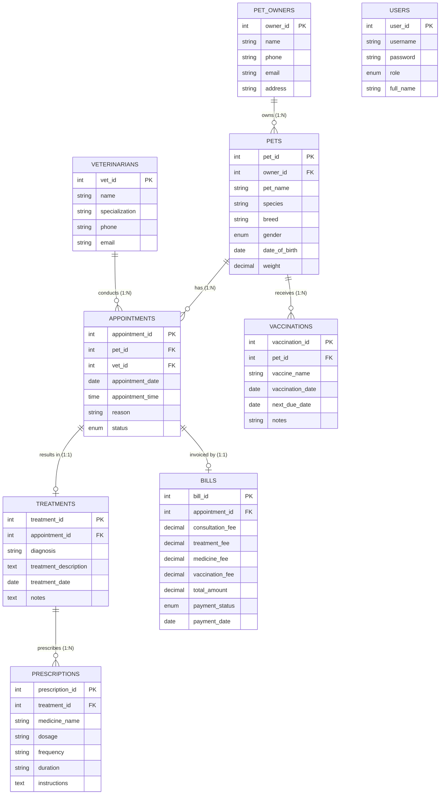

# 🐾 PetCare+ — Smart Pet Clinic Management System
### Relational Database Management System (DBMS) College Project
**Department of Computer Science & Engineering**

---

## 📌 1. Project Overview

**PetCare+** is a complete, full-stack relational database management system designed to streamline and modernize veterinary clinic operations. It manages patient records, doctor scheduling, clinical diagnoses, vaccination reminders, pharmacy prescriptions, and billing workflows while enforcing database normalization (1NF, 2NF, 3NF), referential integrity constraints, concurrency conflict safeguards (double-booking prevention), and ACID-compliant transactions.

### Key Highlights
- **Architecture**: Lightweight Model-View-Controller (MVC) with Python Flask, MySQL, and vanilla HTML5/CSS3/JavaScript.
- **Pure Relational Database**: Normalized schema with 9 tables, explicit foreign keys, cascade rules, check constraints, composite indexes, and database views.
- **Real-Time Double-Booking Safeguard**: Automatically prevents scheduling a veterinarian for overlapping appointments at the same date and time.
- **Role-Based Access Control (RBAC)**: Secure multi-role access for `Admin`, `Receptionist`, and `Veterinarian`.
- **Security**: Parameterized SQL queries (preventing SQL injection) and Werkzeug `scrypt` cryptographic password hashing.

---

## 📂 2. Exact Project Directory Structure

```text
DB_project/
│
├── app.py                      # Main Flask application with routes and controllers
├── config.py                   # Central configuration & database connection parameters
├── db.py                       # Safe database connector & query execution helper
├── init_db.py                  # One-click Python script to initialize MySQL schema & data
├── requirements.txt            # Python dependencies (Flask, mysql-connector-python, Werkzeug)
├── README.md                   # Comprehensive project documentation & viva guide
│
├── database/
│   ├── schema.sql              # DDL: Database creation, tables, constraints, indexes, views
│   ├── sample_data.sql         # DML: Realistic sample records with hashed user passwords
│   └── queries.sql             # 25 curated demonstration SQL queries for viva & reports
│
├── templates/
│   ├── base.html               # Master layout with responsive sidebar and top navbar
│   ├── login.html              # Login page with demo credentials quick-fill buttons
│   ├── dashboard.html          # Clinic metrics, KPI cards, today's schedule & alerts
│   ├── owners.html             # Pet owner directory (CRUD & search)
│   ├── pets.html               # Pet patient records with species filtering (CRUD & search)
│   ├── pet_detail.html         # Comprehensive medical dossier (visits, treatments, vaccines)
│   ├── veterinarians.html      # Doctor directory with specialization badges (Admin only)
│   ├── appointments.html       # Scheduling management with collision prevention
│   ├── treatments.html         # Clinical diagnoses and treatment logs
│   ├── vaccinations.html       # Preventive care tracking with upcoming/overdue alerts
│   ├── prescriptions.html      # Medication administration linked to clinical treatments
│   ├── billing.html            # Invoicing with dynamic client-side fee auto-calculation
│   └── reports.html            # Analytical reports powered by SQL GROUP BY & Views
│
├── static/
│   ├── css/
│   │   └── style.css           # Modern veterinary-themed CSS (responsive, clean, professional)
│   └── js/
│       └── script.js           # Client-side interactions, modal dialogs, and fee calculators
│
└── screenshots/                # Folder for application interface screenshots
```

---

## 💻 3. Step-by-Step Windows Setup Guide (Zero to Running)

Follow these exact steps to set up and run the project from scratch on any Windows machine:

### Step 1: Install Python
1. Download Python 3.10+ (or newer) from [python.org](https://www.python.org/).
2. Run the installer and **ensure you check the box: "Add Python to PATH"**.

### Step 2: Install MySQL Server
1. Download and install **MySQL Community Server** (or XAMPP with MySQL).
2. During installation, set a root password (e.g., `Adisjce@2028` or your own password).
3. Ensure the MySQL Windows Service (`MySQL80`) is running.

### Step 3: Configure Database Credentials
Open [`config.py`](config.py) in any text editor and update your MySQL credentials if they differ from the defaults:
```python
MYSQL_HOST = 'localhost'
MYSQL_PORT = 3306
MYSQL_USER = 'root'
MYSQL_PASSWORD = 'YOUR_MYSQL_PASSWORD_HERE'  # Set your MySQL root password
MYSQL_DB = 'petcare_db'
```

### Step 4: Set Up Virtual Environment & Dependencies
Open **Command Prompt (cmd)** or **PowerShell** in the project directory (`c:\Users\Adithya V\Downloads\DB_project`) and execute:

```cmd
# 1. Create a Python virtual environment
python -m venv venv

# 2. Activate the virtual environment
# In Command Prompt (cmd):
venv\Scripts\activate.bat
# OR in PowerShell:
venv\Scripts\Activate.ps1

# 3. Upgrade pip and install all required packages
pip install --upgrade pip
pip install -r requirements.txt
```

### Step 5: Initialize the Database (One-Click Automated Method)
Run the built-in database initializer script which creates the database, loads the schema, views, indexes, and all sample data automatically:
```cmd
python init_db.py
```
*(Alternative Manual Method via MySQL CLI:)*
```cmd
mysql -u root -p -e "source database/schema.sql; source database/sample_data.sql;"
```

### Step 6: Start the Flask Application
Run the main application:
```cmd
python app.py
```

### Step 7: Open the Application in your Browser
Open your browser and navigate to:
```
http://127.0.0.1:5000
```

---

## 🔑 4. Default Login Credentials

| Role | Username | Password | Access Rights |
| :--- | :--- | :--- | :--- |
| **Admin** | `admin` | `admin123` | Full administrative control: all tables, doctor management, cascade deletes, billing, reports |
| **Receptionist** | `receptionist` | `recep123` | Front desk operations: Pet owners, pets, booking appointments, billing generation & payments |
| **Veterinarian** | `drsmith` | `vet123` | Clinical operations: View patient dossier, record diagnoses/treatments, log vaccinations, prescribe meds |

> **Note**: On the login page, you can click any of the **Quick Demo Buttons** to automatically fill in the username and password!

---

## 🗄️ 5. Database Schema & Architecture

### Table Definitions & Primary/Foreign Keys

| # | Table Name | Primary Key | Foreign Keys | Key Attributes & Constraints |
| :--- | :--- | :--- | :--- | :--- |
| 1 | `users` | `user_id` | *None* | `username` (UNIQUE), `password` (hashed), `role` (ENUM: Admin, Receptionist, Veterinarian), `full_name` |
| 2 | `pet_owners` | `owner_id` | *None* | `name`, `phone`, `email` (UNIQUE), `address` |
| 3 | `pets` | `pet_id` | `owner_id` &rarr; `pet_owners(owner_id)` [CASCADE] | `pet_name`, `species`, `breed`, `gender`, `date_of_birth`, `weight` (CHECK > 0) |
| 4 | `veterinarians` | `vet_id` | *None* | `name`, `specialization`, `phone`, `email` (UNIQUE) |
| 5 | `appointments` | `appointment_id` | `pet_id` &rarr; `pets(pet_id)` [CASCADE]<br>`vet_id` &rarr; `veterinarians(vet_id)` [RESTRICT] | `appointment_date`, `appointment_time`, `reason`, `status` (ENUM: Scheduled, Completed, Cancelled) |
| 6 | `treatments` | `treatment_id` | `appointment_id` &rarr; `appointments(appointment_id)` [CASCADE] | `appointment_id` (UNIQUE - 1:1 relation), `diagnosis`, `treatment_description`, `treatment_date`, `notes` |
| 7 | `vaccinations` | `vaccination_id` | `pet_id` &rarr; `pets(pet_id)` [CASCADE] | `vaccine_name`, `vaccination_date`, `next_due_date` (CHECK next >= current), `notes` |
| 8 | `prescriptions` | `prescription_id` | `treatment_id` &rarr; `treatments(treatment_id)` [CASCADE] | `medicine_name`, `dosage`, `frequency`, `duration`, `instructions` |
| 9 | `bills` | `bill_id` | `appointment_id` &rarr; `appointments(appointment_id)` [CASCADE] | `appointment_id` (UNIQUE - 1:1 relation), `consultation_fee`, `treatment_fee`, `medicine_fee`, `vaccination_fee`, `total_amount`, `payment_status` (ENUM: Unpaid, Paid), `payment_date` |

---

## 📊 6. Entity-Relationship (ER) Diagram



### Cardinality and Relationship Analysis
1. **`pet_owners` to `pets` (1 : N)**: One owner can register multiple pets. A pet belongs to exactly one owner.
2. **`pets` to `appointments` (1 : N)**: A pet can have multiple appointments over time.
3. **`veterinarians` to `appointments` (1 : N)**: A veterinarian attends multiple appointments.
4. **`appointments` to `treatments` (1 : 1)**: An appointment may result in at most one medical treatment record. Enforced by `UNIQUE(appointment_id)`.
5. **`treatments` to `prescriptions` (1 : N)**: A medical treatment can include multiple prescribed medications.
6. **`pets` to `vaccinations` (1 : N)**: A pet can receive multiple vaccination boosters throughout its life.
7. **`appointments` to `bills` (1 : 1)**: Each completed visit has a single itemized billing invoice. Enforced by `UNIQUE(appointment_id)`.

---

## 📐 7. Database Normalization Explanation (1NF &rarr; 2NF &rarr; 3NF)

### First Normal Form (1NF)
- **Rule**: Every column must contain atomic (indivisible) values, and each record must be unique with a defined Primary Key. No repeating groups.
- **Implementation**:
  - Instead of comma-separated phone numbers or medicines stored in an appointment, each medicine is an individual atomic row in `prescriptions`.
  - Every table has an explicit single-column Primary Key (`owner_id`, `pet_id`, `appointment_id`, etc.).

### Second Normal Form (2NF)
- **Rule**: Must be in 1NF and have **no partial functional dependency** (every non-key attribute must depend fully on the primary key, not part of a composite key).
- **Implementation**:
  - All tables in PetCare+ utilize surrogate single-column primary keys (e.g., `appointment_id`).
  - By definition, partial functional dependency cannot exist because there are no composite primary keys where an attribute depends on only a subset of the key.

### Third Normal Form (3NF)
- **Rule**: Must be in 2NF and have **no transitive functional dependencies** (non-prime attributes must not depend on other non-prime attributes: $X \to Y \to Z$).
- **Implementation**:
  - Pet owner contact details are stored in `pet_owners` rather than repeated inside `pets` or `appointments`. If owner phone was in `appointments`, it would depend on `pet_id` which depends on `appointment_id` (a transitive dependency).
  - Doctor specialization is stored in `veterinarians`, not inside `appointments`.
  - In `prescriptions`, medicine details reference `treatment_id`, eliminating redundancy from `appointments`.

---

## 🔍 8. Key Demonstration SQL Queries

The file [`database/queries.sql`](database/queries.sql) contains **25 complete SQL queries** demonstrating key DBMS topics:

| Topic | Sample Query Snippet |
| :--- | :--- |
| **Multi-Table JOIN** | `SELECT a.appointment_id, p.pet_name, o.name AS owner_name, v.name AS vet_name FROM appointments a JOIN pets p ON a.pet_id = p.pet_id JOIN pet_owners o ON p.owner_id = o.owner_id JOIN veterinarians v ON a.vet_id = v.vet_id;` |
| **Aggregations & GROUP BY** | `SELECT species, COUNT(*) AS total_registered, ROUND(AVG(weight), 2) AS avg_weight FROM pets GROUP BY species;` |
| **HAVING Filter** | `SELECT v.name, COUNT(a.appointment_id) AS visits FROM veterinarians v JOIN appointments a ON v.vet_id = a.vet_id WHERE a.status = 'Completed' GROUP BY v.vet_id, v.name HAVING COUNT(a.appointment_id) >= 2;` |
| **Subquery (NOT IN)** | `SELECT * FROM pet_owners WHERE owner_id NOT IN (SELECT DISTINCT p.owner_id FROM pets p JOIN appointments a ON p.pet_id = a.pet_id WHERE a.status = 'Scheduled');` |
| **Correlated Subquery** | `SELECT * FROM pets p1 WHERE p1.weight > (SELECT AVG(p2.weight) FROM pets p2 WHERE p2.species = p1.species);` |
| **Date Arithmetic** | `SELECT v.vaccine_name, p.pet_name, DATEDIFF(v.next_due_date, CURDATE()) AS days_left FROM vaccinations v JOIN pets p ON v.pet_id = p.pet_id WHERE v.next_due_date <= DATE_ADD(CURDATE(), INTERVAL 30 DAY);` |
| **ACID Transaction** | `START TRANSACTION; UPDATE appointments SET status = 'Completed' WHERE appointment_id = 9; INSERT INTO treatments (...) VALUES (...); COMMIT;` |

---

## 🎓 9. How to Demonstrate the Project to Your DBMS Lecturer

When presenting PetCare+ to your examiner/lecturer, follow this sequential 5-minute walkthrough:

1. **Architecture & Login Demo**:
   - Open `http://127.0.0.1:5000/login`.
   - Explain Werkzeug `scrypt` password hashing and role-based permissions (`Admin`, `Receptionist`, `Veterinarian`).
   - Use the demo quick-fill chip to log in as **Admin**.

2. **Dashboard & Relational Metrics**:
   - Showcase the 7 KPI cards dynamically populated using SQL `COUNT(*)`, `SUM()`, and date-based `BETWEEN` queries.
   - Show how the today's appointments table and urgent vaccination alerts are computed in real time.

3. **Pet Owner & Pet Management (1:N Relationship & Cascading)**:
   - Go to **Pet Owners**, show search by keyword.
   - Go to **Pets**, filter by species (e.g. Dog vs Cat).
   - Click on **Max** or **Bella** to open the **Pet Medical Dossier** (`/pets/<id>`) showing their chronological visits, clinical treatments, and vaccination history.

4. **Appointment Booking & Concurrency Conflict Safeguard**:
   - Go to **Appointments**.
   - Attempt to book an appointment with a doctor at a time they are already booked (e.g. `Dr. Emily Chen` on `2026-09-28` at `10:00:00`).
   - Show the examiner how the system intercepts and blocks the double-booking with an explicit flash error.

5. **Clinical Workflow & ACID Transaction**:
   - Go to **Treatments**. Show how recording a diagnosis and treatment executes an atomic transaction:
     - Updates appointment status to `Completed`.
     - Inserts the medical record into `treatments`.
     - Automatically creates a baseline invoice record in `bills`.

6. **Invoicing & Dynamic Billing**:
   - Open **Billing**. Show how client-side JavaScript recalculates fees dynamically while backend SQL enforces constraints.
   - Click **Mark Paid** to update the invoice status and set `payment_date = CURDATE()`.

7. **DBMS Reports Showcase**:
   - Navigate to **DBMS Reports**.
   - Show the examiner the SQL concepts behind each section: `GROUP BY` species, `JOIN` with veterinarian revenue, and database views like `view_upcoming_vaccinations`.

---

## ❓ 10. Common DBMS Viva Questions and Answers

### Q1: What database engine did you use, and why?
**Answer**: We used **MySQL InnoDB**. InnoDB supports relational foreign keys, referential integrity (`ON DELETE CASCADE`), row-level locking, and full ACID transaction compliance (`COMMIT` and `ROLLBACK`).

### Q2: What is the difference between WHERE and HAVING?
**Answer**: 
- `WHERE` filters individual rows *before* any grouping occurs.
- `HAVING` filters aggregated groups *after* `GROUP BY` has been performed (e.g., `HAVING COUNT(appointment_id) >= 2`).

### Q3: What happens when an owner is deleted? How does the database handle related data?
**Answer**: We defined `ON DELETE CASCADE` on the `pets` table for `owner_id`. When an owner is deleted, MySQL automatically deletes all their pets, which in turn cascades to delete their appointments, treatments, vaccinations, prescriptions, and bills. This guarantees no orphaned rows remain.

### Q4: Why did you use RESTRICT on the veterinarian foreign key in appointments?
**Answer**: We used `ON DELETE RESTRICT` so that a clinic cannot accidentally delete a doctor from the database if there are historical appointment records attached to that doctor. The doctor must first be reassigned or appointments cancelled.

### Q5: What is a Database View, and why did you use them?
**Answer**: A View is a virtual table defined by an underlying SQL query. We created views like `view_appointment_details` and `view_upcoming_vaccinations` to encapsulate complex 3-way and 4-way `JOIN`s, making application code cleaner and providing an abstraction layer over raw tables.

### Q6: How do you prevent SQL Injection in your project?
**Answer**: We never concatenate user input strings into SQL statements. Instead, we use **parameterized queries** with `%s` placeholders via `mysql-connector-python`. The database driver ensures inputs are treated strictly as data literals, neutralizing any SQL injection payload.

### Q7: Explain the ACID properties with an example from PetCare+.
**Answer**:
- **Atomicity**: In `add_treatment`, recording treatment and setting appointment status to 'Completed' succeed together or fail together.
- **Consistency**: All check constraints (e.g., `total_amount >= 0`, `weight > 0`) and foreign keys must remain valid after the transaction.
- **Isolation**: Simultaneous bookings do not interfere with each other due to transaction isolation and locking.
- **Durability**: Once a bill or treatment is committed with `conn.commit()`, the data persists on disk even if the server restarts.

### Q8: What indexes did you create, and how do they improve performance?
**Answer**: We created indexes on frequently filtered and joined columns:
- `idx_appointments_date_vet` on `appointments(appointment_date, vet_id)` for quick double-booking detection and daily schedule lookups.
- `idx_pets_species` on `pets(species)` for fast species filtering.
- `idx_bills_status` on `bills(payment_status)` for quick unpaid bill queries.
- `idx_vaccinations_due` on `vaccinations(next_due_date)` for fast range scans.

---

## 👨‍💻 Project Developer Notes
- **Academic Year**: 2026
- **Course**: Database Management Systems (CS304/DBMS)
- **Target OS**: Windows 10/11
- **Stack**: Python Flask, MySQL Server 8.0, HTML5, CSS3, JavaScript
